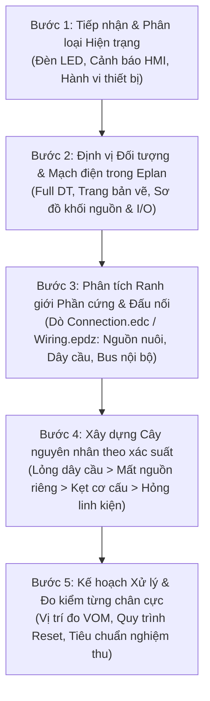

# Kỹ năng Xử lý Sự cố & Chẩn đoán Lỗi Hệ thống (Troubleshooting)

Kỹ năng này hướng dẫn Agent tiếp nhận hiện trạng sự cố từ người dùng (hiện tượng mắt thấy, trạng thái đèn LED, đo kiểm VOM, hành vi bất thường của máy), đối chiếu với thiết kế chi tiết trong các file Eplan export (`Connection.edc`, `Wiring.epdz`, `Device.edc`, `Bill_of_materials.XML`, `Project.aml`, `Project.epj`) để khoanh vùng nguyên nhân gốc rễ và đưa ra giải pháp xử lý chính xác theo từng chân cực thiết bị.

---

## 1. Nguyên tắc vàng trong Troubleshooting

1. **Không phán đoán cảm tính:** Mọi chẩn đoán phải dựa trên chuỗi đấu dây thực tế trong Eplan (`Source -> Target`, `Wire ID`, `Terminal ID`), không đưa ra lời khuyên chung chung.
2. **Tách bạch tầng Logic và tầng Công suất:**
   - *Tầng Logic/Truyền thông:* Ví dụ Backplane Bus $5\text{ V DC}$ của PLC nuôi chip vi xử lý của các module mở rộng.
   - *Tầng Ngoại vi/Công suất:* Nguồn $24\text{ V DC}$ tại cọc $L+/M$ giắc `X10`, nguồn cấp tiếp điểm relay `1L/2L` tại giắc `X12`.
   - Mất nguồn ngoại vi không làm sập tầng logic (CPU vẫn RUN, không báo mất module).
3. **Phân tích theo hướng "Từ nguồn đến tải" (Downstream Traceability):** Lần theo thứ tự cấp điện (Aptomat $\rightarrow$ Rơ-le an toàn $\rightarrow$ Busbar $\rightarrow$ Khối phân phối $\rightarrow$ Cầu đấu $\rightarrow$ Thiết bị chấp hành).
4. **Xác lập kịch bản theo xác suất thực tế:** Ưu tiên kiểm tra các vị trí cơ học dễ phát sinh lỗi trước (tuột cosse đôi tại chân cầu, lỏng ốc, đứt dây ngầm, nút E-stop bị ấn, kẹt hành trình) trước khi kết luận hỏng phần cứng hoặc lỗi phần mềm.

---

## 2. Quy trình chẩn đoán 5 bước chuẩn hóa

### Bước 1: Tiếp nhận và chuẩn hóa hiện trạng (Symptom Intake)
Thu thập và làm rõ 4 thông số hiện trường từ người dùng:
- **Thiết bị nào còn nguồn / mất nguồn?** (Ví dụ: CPU có nguồn, module mở rộng mất nguồn).
- **Trạng thái đèn chỉ thị (LED):** Đèn `RUN/STOP`, `ERROR`, `DIAG` trên PLC/Module; đèn `PWR`, `K1/K2` trên Safety Relay; đèn tín hiệu trên Sensor.
- **Có cảnh báo lỗi trên HMI/PLC không?** Nếu CPU không báo lỗi, cần ghi nhận đây là manh mối then chốt (chứng tỏ bus logic vẫn lành lặn).
- **Hành vi vật lý của máy:** Máy dừng ở bước nào, cơ cấu nào không chuyển động.

### Bước 2: Định vị đối tượng và mạch điện trong Eplan
- Tra cứu vị trí trang và tọa độ sơ đồ của cụm thiết bị gặp sự cố trong `Bill_of_materials.XML` hoặc `Device.edc`.
- Xác định sơ đồ nguyên lý tổng thể của trang (ví dụ Trang 3: `PLC - Devices`, Trang 4: `Button`, Trang 5: `VFD`, Trang 7: `Sensor`).

### Bước 3: Phân tích ranh giới phần cứng & Dò chuỗi kết nối
- Tra cứu file [Connection.edc](../../Export_ProjectData_Sanitized/External_editing/Connection.edc) và [Wiring.epdz](../../Export_ProjectData_Sanitized/External_editing/Wiring.epdz):
  - **Dò đường cấp nguồn dương ($+24\text{ V DC}$):** Kiểm tra xem nguồn đi từ đâu đến, có đi qua tiếp điểm rơ-le an toàn hay tiếp điểm phụ không.
  - **Dò chuỗi cầu nguồn (Daisy-chain):** Kiểm tra các đoạn dây cầu nối tiếp giữa các thiết bị (ví dụ từ chân `1K1:X10:1` sang `1K4:X10:1` rồi sang `2K1:X10:1`).
  - **Dò đường mass chung ($0\text{ V DC}$):** Kiểm tra chân âm `M` và `Common` (`1M/2M`).
  - **Dò nguồn tiếp điểm công suất:** Kiểm tra các chân cấp nguồn cho tải riêng biệt (như chân `1L/2L` trên module ngõ ra relay).

### Bước 4: Xây dựng cây nguyên nhân gốc rễ
Sắp xếp nguyên nhân theo thứ tự xác suất giảm dần:
1. *Cấp 1 — Lỗi cơ học đấu nối:* Tuột cosse, lỏng ốc siết, đứt dây cầu tại các điểm bấm 2 dây trên 1 cọc.
2. *Cấp 2 — Mạch bảo vệ/An toàn ngắt:* Nút E-stop bị nhấn, rơ-le an toàn trip, nhảy aptomat nhánh, hở công tắc cửa.
3. *Cấp 3 — Mất nguồn riêng của tải:* Đứt cầu chì hoặc mất nguồn cấp cho thanh cái relay.
4. *Cấp 4 — Hỏng phần cứng hoặc cấu hình phần mềm:* Cháy module, xung đột địa chỉ, ngắn mạch chéo nội bộ.

### Bước 5: Đưa ra hướng xử lý và vị trí đo kiểm cụ thể
- Chỉ định **chính xác tên cọc và chân cực** cần đo đồng hồ VOM (ví dụ: *"Đặt que đo đỏ vào chân X10:1 của 1K4 và que đen vào chân X10:2 của 1K1"*).
- Hướng dẫn thao tác khắc phục an toàn: Siết ốc, cắm lại giắc, kiểm tra tiếp xúc cosse.
- Hướng dẫn chu trình Reset / Khởi động lại hệ thống sau khi khắc phục xong.

---

## 3. Các ca điển hình đã kiểm chứng trong dự án

### Ca 1: Rơ-le an toàn `15K4` TRIP (Safety System Cut-off)
* **Hiện tượng:** Máy dừng khẩn, đèn `PWR` trên 15K4 sáng nhưng đèn `K1/K2` tắt. Màn hình HMI báo mất kết nối PLC.
* **Cơ chế từ Eplan:** Chân ngõ ra an toàn `15K4:14` mở ra $\rightarrow$ Cắt nguồn nuôi CPS (+) vào chân `1K1:X10:1` $\rightarrow$ Toàn bộ CPU S7-1200 và các module `1K4`, `2K1` mất nguồn, ngắt cưỡng bức mọi ngõ ra van và biến tần.
* **Xử lý:** Kiểm tra giải tỏa các nút E-stop $\rightarrow$ Đo điện áp chờ tại chân `13` $\rightarrow$ Nhấn nhả nút Reset an toàn tại chân `S34` để kích hoạt lại (chế độ Manual Monitored Start).

### Ca 2: CPU PLC vẫn RUN, không báo lỗi, nhưng các Module mở rộng mất nguồn
* **Hiện tượng:** Đèn CPU S7-1200 `1K1` vẫn XANH (RUN), không có báo động mất phần cứng, nhưng toàn bộ cảm biến không nhận, van khí nén không tác động, máy treo cứng.
* **Cơ chế từ Eplan:** CPU nuôi tầng logic của module mở rộng qua Backplane Bus $5\text{ V DC}$ nội bộ nên không báo lỗi thiếu module. Nguồn ngoại vi $24\text{ V DC}$ tại `X10:1` và `X10:2` được đấu cầu từ `1K1` sang `1K4` rồi sang `2K1`.
* **Xử lý:** Đo VOM tại cọc `1K1:X10` (có 24V) đối chiếu với cọc `1K4:X10` (mất 24V) $\rightarrow$ Khoanh vùng chính xác đứt/tuột dây cầu đỏ `18/15528` hoặc dây trắng `18/15532` giữa CPU và module đầu tiên.

---

## 4. Danh mục tài liệu tham chiếu
- [Bản đồ thuộc tính Eplan](../../Content/02_PROPERTY_MAP.md)
- [Nhật ký bài học kinh nghiệm](../../Content/06_LEARNING_LOG.md)
- [Quy tắc kiểm tra cảm biến NPN/PNP & PLC Common](../../Content/06_LEARNING_LOG.md#2026-11-17--phương-pháp-kiểm-chứng-tương-thích-cảm-biến-npnpnp-và-ngõ-vào-plc)
- [Quy trình 4 bước tra cứu nguyên lý thiết bị (LL-004)](../../Content/06_LEARNING_LOG.md#2026-11-17--ll-004-quy-trình-4-bước-tra-cứu-và-phân-tích-nguyên-lý-thiết-bị-approved)
